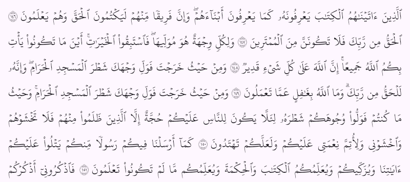

# HElkady-Mushaf

An electronic Mushaf (Hafs narration) for Android, built with Flutter. The King Fahd Complex mushaf text and typeface, with tafsir, search and bookmarks. Works fully offline, no ads.

مصحف إلكتروني برواية حفص للأندرويد، مبني بفلاتر: نص وخط مجمع الملك فهد لطباعة المصحف الشريف، مع تفاسير وبحث وعلامات. يعمل بدون نت وبدون إعلانات.

## Screenshots

<p align="center">
  
</p>
<p align="center">
  
</p>

## Features

- The full Quran in the King Fahd Complex Hafs typeface (KfgqpcHafs), laid out by mushaf page
- Surah index with revelation type, ayah count and page number, plus a "continue reading" banner that returns you to where you stopped
- Tafsir per ayah: Al-Muyassar, Ibn Kathir, Al-Jalalayn and Al-Saadi, selectable in settings
- Search across the whole mushaf; every result shows its surah, ayah and page
- Bookmarks: tap any ayah while reading to save it
- Adjustable mushaf font size; light, dark and system themes
- Fully offline: the text, tafsir and font are bundled with the app

## بالعربي

- المصحف كامل بخط مجمع الملك فهد (رواية حفص)، ومترتب على صفحات المصحف
- فهرس السور بنوع السورة وعدد آياتها ورقم صفحتها، مع شريط «متابعة القراءة» اللي يرجعك لمكان ما وقفت
- تفسير لكل آية: الميسر، ابن كثير، الجلالين والسعدي، وتختار بينهم من الإعدادات
- بحث في المصحف كله، وكل نتيجة توضح السورة والآية والصفحة
- علامات: اضغط على أي آية أثناء القراءة واحفظها
- التحكم في حجم خط المصحف، ومظهر فاتح أو داكن أو تلقائي
- يعمل بدون نت: النص والتفاسير والخط موجودين جوه التطبيق

## Run

```bash
flutter pub get
flutter run
```

Golden tests: `flutter test` renders mushaf pages and compares them with the reference images in `test/`.

## Data and font

- Quran text and the four tafsir books are bundled as compressed JSON in `assets/data/`
- KfgqpcHafs typeface from the King Fahd Glorious Quran Printing Complex
